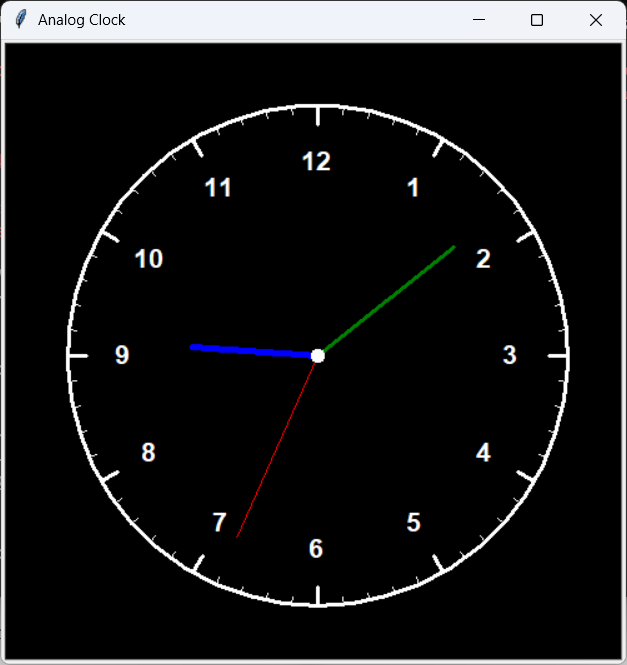

# Analog Clock

Horloge analogique en Python avec turtle : cadran, chiffres 1 à 12, aiguilles heures/minutes/secondes.

## Lancer

Prérequis : `pip install tzdata` (Windows).

- Clic dans la fenêtre : thème clair / sombre
- Touche `T` : changer de ville (Cotonou, Paris, New York, Tokyo)

    python clock_application.py

    

